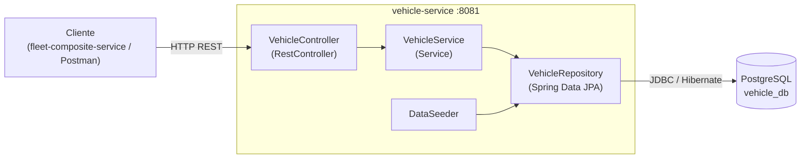
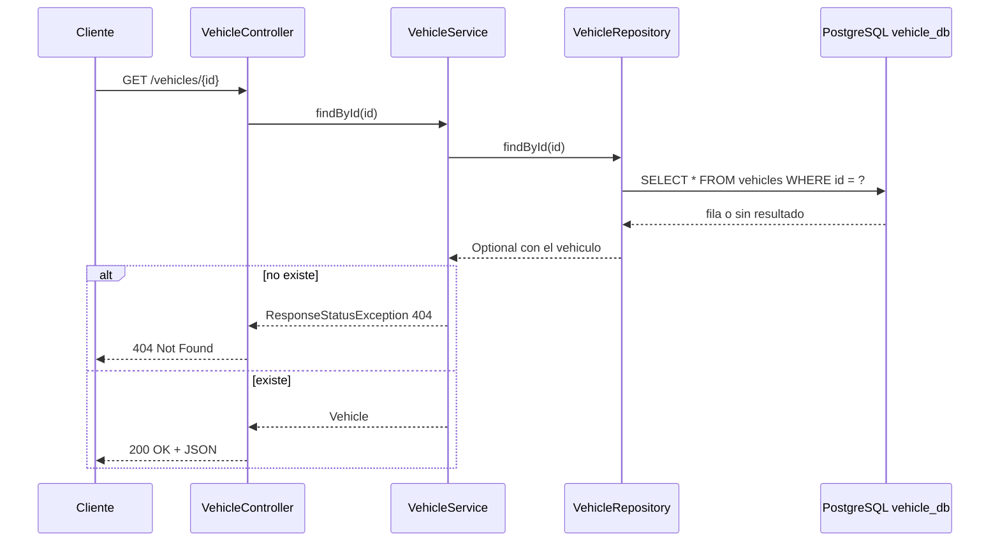

# vehicle-service

Microservicio de gestión de vehículos: información técnica, estado de la batería/motor, última ubicación y mantenimiento. Base de datos propia `vehicle_db`.

**Stack:** Java 17 · Spring Boot 3.3 · Maven · PostgreSQL  
**Puerto:** 8081

## Endpoints

| Método | Ruta | Descripción |
|---|---|---|
| GET | `/vehicles` | Lista todos los vehículos |
| GET | `/vehicles/{id}` | Obtiene un vehículo (404 si no existe) |
| POST | `/vehicles` | Crea un vehículo (201 + Location) |

## Modelo (`vehicles`)

`id`, `plate`, `model`, `batteryStatusPercentage`, `engineStatus`, `lastLatitude`, `lastLongitude`, `lastMaintenanceDate`


## Cómo ejecutarlo

```bash
# Antes: CREATE DATABASE vehicle_db;  (desde psql)
mvn spring-boot:run
```

## Diagramas

Los diagramas editables en draw.io están en `docs/vehicle-service-diagramas.drawio` (páginas: componentes y secuencia).
Las mismas vistas en Mermaid (se renderizan directo en GitHub):

### Componentes



### Secuencia


